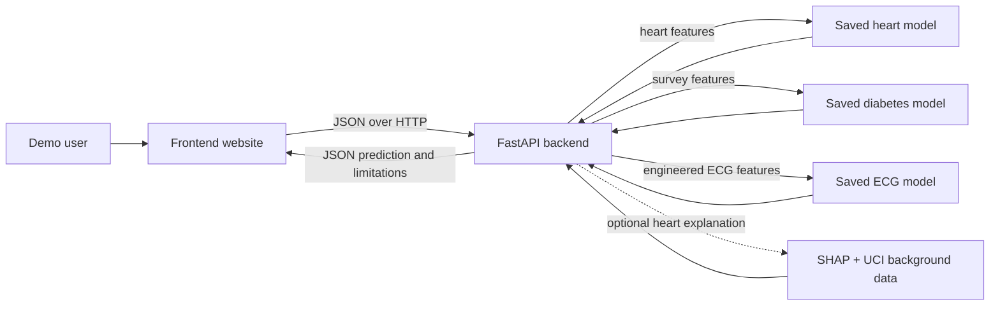

# CardioTwin Backend Architecture

## Request flow

## Components

1. **Frontend:** Collects demo inputs and displays the returned model output. It calls the backend API; it does not load model files.
2. **FastAPI backend (`main.py`):** Checks request fields, selects the matching saved model, runs inference, and returns JSON. The API provides `/docs` for interactive requests.
3. **Saved model artifacts (`cardiotwin_artifacts/`):** Contains separate heart disease, diabetes survey, and ECG beat model files plus metadata. The backend does not train or overwrite them.
4. **SHAP explanation:** Optional for heart predictions. It uses the original Cleveland dataset file in `cardiotwin_artifacts/` to recreate the notebook's 30-row background sample.

## Data flow and boundaries

- Each prediction route accepts only the corresponding model's feature schema. See [`API_CONTRACT.md`](API_CONTRACT.md).
- The ECG route requires engineered ECG features with `V1` inputs. It does not process raw wearable waveforms.
- The models were developed from different datasets and are not linked by patient. The API returns separate predictions and does not calculate a combined CardioTwin risk score.
- Requests and predictions are not saved in a database.
